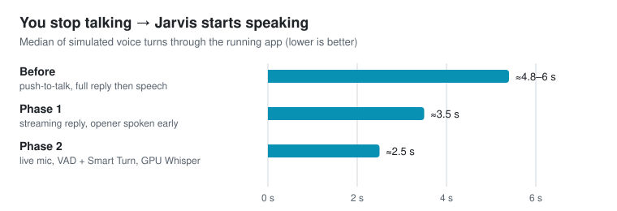
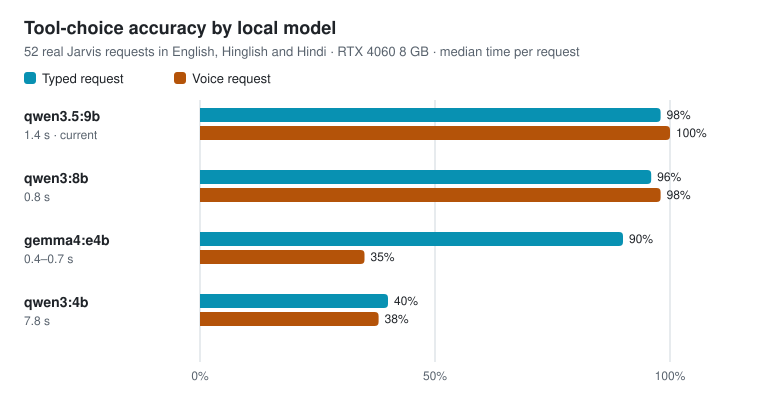
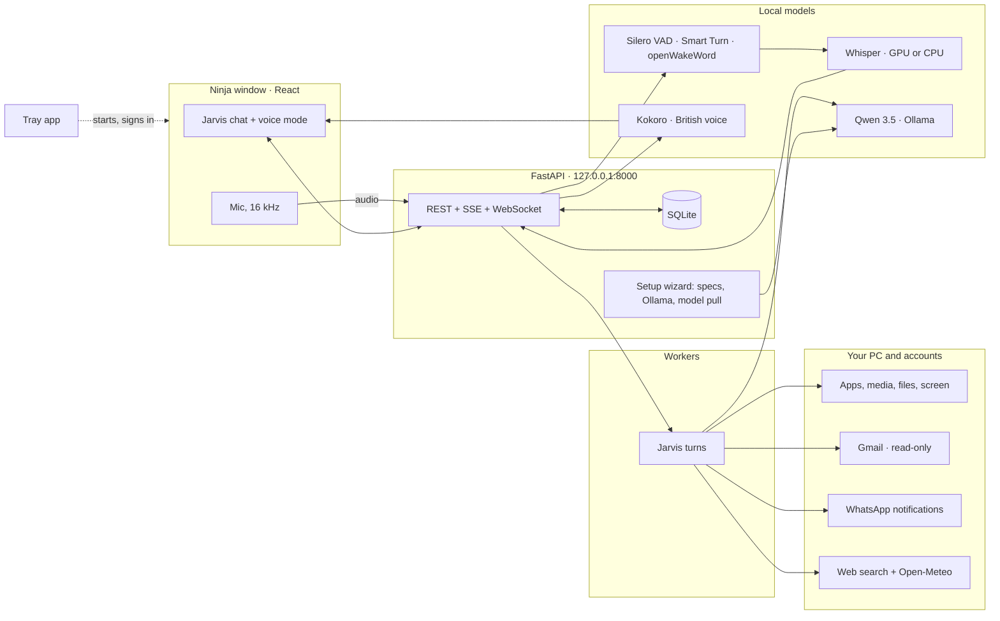

<div align="center">


# Ninja Assistant

**Your own Jarvis, on your PC. A private voice assistant for Windows that talks in English, Hindi and Hinglish, and actually does things: opens apps, finds files, researches the web, reads your mail and reminds you. Nothing you say leaves your computer.**

[**Website**](https://karthik6146.github.io/Ninja-Assistant/) · [**Download**](https://github.com/Karthik6146/Ninja-Assistant/releases/latest) · [User guide](docs/user-guide.md) · [Jarvis guide](docs/jarvis-guide.md)


</div>

---

## What it is

Ninja runs entirely on your own PC. **Jarvis**, its assistant, is a calm British butler who calls you "sir", listens for **"Hey Jarvis"**, lets you talk over him, and answers in the language you choose, switching mid-conversation when you say so.

Speech recognition, the language model and the voice all run locally. There is no Ninja server, no account and no subscription. Setup is one double-click: a wizard checks your PC and installs the model that fits it.

| Ask Jarvis… | What happens |
|---|---|
| "Noida ka mausam kaisa hai?" | Live weather (Open-Meteo) |
| "Research the best microphones under ₹5000" | Searches the web, reads up to 3 pages, answers with sources |
| "VLC kholo" · "volume badhao" · "next song" | Opens any Start-menu app or Settings page; controls media and volume |
| "Find my Valorant clip and open it" | Searches Desktop, Documents, Downloads, Videos, Pictures and Music |
| "Check CPU and memory" | Live CPU, memory, disk and the largest files |
| "Any new emails?" | Reads your connected Gmail accounts (read-only) |
| "Koi WhatsApp message aaya?" | Reads WhatsApp Desktop notifications (read-only) |
| "Remind me tomorrow at 7 PM…" | Reminders, a Today list and saved preferences |
| "Screen pe kya hai?" | Looks at your screen and describes it |

Risky actions wait for an **Allow once / Deny** card. Once Jarvis has read email, web, message or document text in a conversation, every further action needs your click, so text written by strangers can't make him act on his own. Every action shows a receipt of the tool that actually ran.

## New in 0.1

- **One-click install.** Download the zip, double-click **Install Ninja**. Python is installed for you if it's missing.
- **Setup wizard.** Reads your memory, GPU and VRAM, CPU and free disk, rates every model **Fast**, **Slow** or **Too big** for your PC, and installs Ollama, the model and voice with live progress.
- **Desktop app with a tray icon.** Its own window, signed in automatically. Closing it keeps Ninja running; the tray shows the server, model and GPU, frees GPU memory and toggles **Start with Windows**.
- **Live model and GPU info.** The chat bar shows GPU temperature, load, VRAM and writing speed. An **i** card shows the model's size, quantization, context and measured speed; the model menu shows each model's VRAM use with an **Unload** button.
- **A cleaner interface.** Graphite design, smoother motion, a clearer Activity page with task details, and a usage page with daily and per-model token counts.
- **Safer web reading.** Jarvis only opens links you or a search result gave him; an invented address becomes a web search instead.

## Performance

<picture>
  <source media="(prefers-color-scheme: dark)" srcset="docs/readme/latency-dark.svg">
  
</picture>

<picture>
  <source media="(prefers-color-scheme: dark)" srcset="docs/readme/models-dark.svg">
  
</picture>

| | |
|---|---|
| Right tool chosen | **52/52** spoken and **51/52** typed requests in English, Hinglish and Hindi (`scripts/eval-tools.py`) |
| Voice reply | about **2.5 s** from the end of your sentence to Jarvis speaking (median) |
| Writing speed | **38 tokens/s** with `qwen3.5:9b`, about **66 tokens/s** with a 4B model |
| GPU memory | about **5.6 GB** of VRAM for `qwen3.5:9b` at Ninja's 8k context, on an 8 GB card |
| Jarvis tools | **30**: research, weather, PC control, files, screen, Gmail, WhatsApp, reminders, memory, notes, clipboard |
| Tests | **355** backend (pytest) · **38** frontend (vitest) |

Measured with the project's own scripts and the app's live model card on the development PC (Ryzen 5 9600X, RTX 4060 8 GB). Latency is the median of simulated voice turns through the running app; check it on your hardware with the **i** card next to the model picker.

## Install

1. Download the latest **Ninja-x.y.z.zip** from [Releases](https://github.com/Karthik6146/Ninja-Assistant/releases/latest) and unzip it anywhere, for example `Documents\Ninja`.
2. Double-click **Install Ninja**. It installs Python 3.11 with winget if needed, sets up Ninja and adds a **Ninja** shortcut to the Desktop and Start menu.
3. Ninja opens the **setup wizard**. Press **Install Ollama**, download the recommended model, optionally set up voice, then **Start using Jarvis**.

No terminal, no config files. You need Windows 10 or 11 with winget (built into current Windows). Run the wizard again any time from **Settings → AI model → Check PC and models**.

| Your PC | Model the wizard picks | What to expect |
|---|---|---|
| NVIDIA GPU, 8 GB or more | `qwen3.5:9b` (6.6 GB) | The best experience; what Ninja is tuned on |
| NVIDIA GPU, 6 GB | `qwen3.5:4b` (3.3 GB) | Quick replies and good tool use |
| No dedicated GPU, 16 GB RAM | `qwen3.5:4b` | Runs on the CPU; replies take longer |
| No dedicated GPU, 8 GB RAM | `qwen3.5:2b` (2.7 GB) | Basic chats and simple commands |

Voice adds about 1.5 GB of speech models. Without a GPU the model runs on the CPU and is slower.

### Using it

Open **Ninja** from the Desktop or Start menu. It lives in the notification area:

- **Click** the tray icon to open or focus the window. Closing the window keeps Ninja running in the background.
- **Right-click** for the server and model status, the GPU line (temperature, load, VRAM, tokens/s), **Free GPU memory**, **Restart server**, **Start with Windows**, **Open data folder** and **Quit Ninja**.
- Voice and the wake word work while the window is open; typed tasks and reminders keep running in the background.

### Optional connections

- **Gmail:** enable the Gmail API in your Google Cloud project, then **Settings → Gmail accounts**.
- **WhatsApp:** install WhatsApp Desktop with notifications on.
- **Cloud model:** set `CLOUD_ENABLED`, `CLOUD_URL`, `CLOUD_MODEL` and `CLOUD_API_KEY` in `.env`. Off by default; each run asks before sharing.

## How it works



- **Turn-taking:** a resident listener runs Silero VAD v6, Smart Turn v3.2 (to decide whether you've finished your sentence) and openWakeWord. Whisper runs on the GPU and falls back to the CPU.
- **Speech:** the reply streams while Qwen is still writing; the first clause is spoken while the rest is generated.
- **Talking over Jarvis:** what you say while he speaks is kept and answered when he finishes. "Stop", "ruko" or "bas karo" interrupt him at once.
- **The agent loop:** a durable job queue and typed tools (Pydantic) with per-capability grants (Allowed / Ask first / Off). An honesty net catches replies that claim an action no tool performed.
- **Sign-in:** the app window gets a one-time code from the launcher and trades it for the local token, so the token never appears in a URL. Google tokens are encrypted with Windows DPAPI.

## Creator tools

Studio (video editing, clip workflows, automations) and YouTube publishing are the author's creator tools and are **off in the public build**: their pages, API routes, scheduler and Jarvis's workflow tools are all disabled. Set `NINJA_CREATOR=1` in `.env` and restart to turn them on.

## Development

```powershell
powershell -ExecutionPolicy Bypass -File scripts/install.ps1   # from a clone: needs Node 22+ to build the UI
powershell -ExecutionPolicy Bypass -File scripts/start.ps1     # server and workers, no tray
.\.venv\Scripts\python.exe -m pytest                       # backend tests
cd frontend; npm test; npm run build                       # frontend tests + build
.\.venv\Scripts\python.exe scripts\eval-tools.py --spoken  # tool-choice eval (needs Ollama)
.\.venv\Scripts\python.exe scripts\compare-models.py qwen3.5:9b qwen3:8b
.\.venv\Scripts\python.exe scripts\review-conversations.py --hours 24   # where real conversations went wrong
powershell -ExecutionPolicy Bypass -File scripts/make-release.ps1 -Version 1.0.0   # release zip + gh command
```

With `scripts/start.ps1`, open **http://127.0.0.1:8000** and connect with the token from `.env` (`NINJA_TOKEN`) or `data/access-token`.

| Path | What |
|---|---|
| `backend/ninja/agent.py` | Jarvis turn loop, prompts, honesty net, confirmations |
| `backend/ninja/*_tools.py`, `gmail.py`, `whatsapp.py`, `desktop.py` | Tools |
| `backend/ninja/setup_routes.py`, `frontend/src/SetupWizard.tsx` | System check, model ratings and installs |
| `backend/ninja/assistant_routes.py`, `frontend/src/ModelPicker.tsx` | Model picker, model card, GPU and speed |
| `scripts/ninja-app.ps1`, `install-app.ps1`, `install.ps1` | Tray app, shortcuts, one-click install |
| `scripts/listener-resident.py`, `voice-resident.py`, `neural-voice-resident.py` | Resident listener, Whisper and Kokoro processes |
| `frontend/src/AssistantConsole.tsx`, `VoiceControls.tsx` | Jarvis screen and voice mode |
| `backend/ninja/youtube*.py`, `studio*.py` | Creator tools (YouTube, Studio) |
| `site/` | The project website, deployed to GitHub Pages |
| `tests/`, `tests/evals/jarvis_tools.jsonl` | Tests and the tool-choice eval |

## Roadmap

- [x] Voice: streaming speech, live turn detection, wake word, talking over Jarvis
- [x] Agent: tool-choice eval, honesty net, confirmation cards
- [x] PC control, research, weather, Gmail, WhatsApp
- [x] One-click install, setup wizard, tray app
- [ ] Voice while the window is closed (run the listener from the tray)
- [ ] Optional: move the real-time loop to Pipecat if latency needs to drop below about 1.5 s

## Limits

- **Personal use:** single user on localhost; not a hosted service. Windows only.
- **WhatsApp:** Jarvis only sees what notifications show: no history, nothing from muted chats.
- **Gmail:** read-only. In Google's testing mode, sign-ins expire every 7 days.
- **Model size:** a local model makes mistakes, more so the smaller ones. Every action shows its tool receipt, and the reply says when nothing was verified.

## Credits

Built on [Ollama](https://ollama.com) and Qwen, [faster-whisper](https://github.com/SYSTRAN/faster-whisper), [kokoro-onnx](https://github.com/thewh1teagle/kokoro-onnx) with [Kokoro-82M](https://huggingface.co/hexgrad/Kokoro-82M), [Silero VAD](https://github.com/snakers4/silero-vad), [Smart Turn](https://github.com/pipecat-ai/smart-turn), [openWakeWord](https://github.com/dscripka/openWakeWord), FastAPI and React. Setup downloads the models; none are bundled in this repository.

The "Hey Jarvis" wake-word model from openWakeWord is licensed CC BY-NC-SA 4.0, **non-commercial use only**. Full third-party licenses: [THIRD_PARTY_NOTICES.md](THIRD_PARTY_NOTICES.md).
