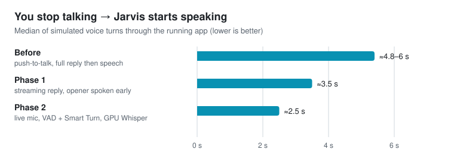
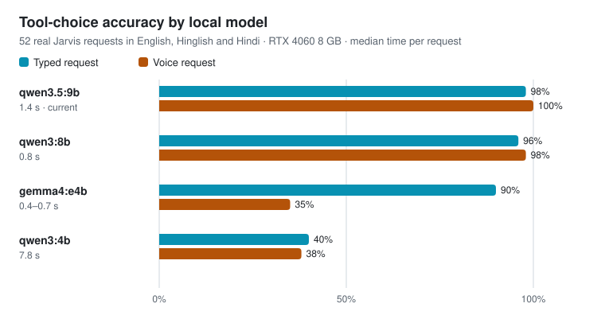
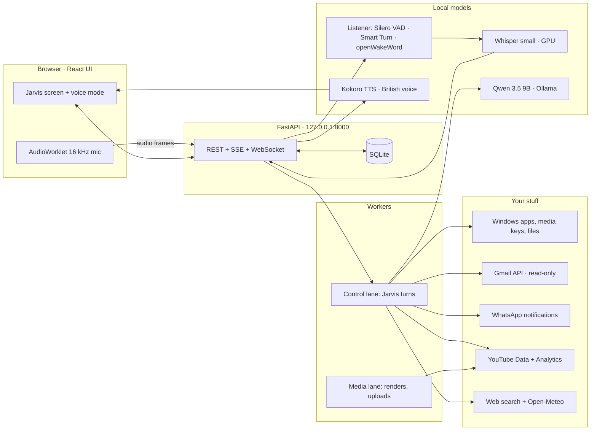

<div align="center">


# Ninja Assistant

**A local-first, JARVIS-style voice assistant for Windows that talks in English, Hindi and Hinglish, and actually does things: your PC, your inbox, your WhatsApp, your YouTube channels.**


</div>

---

## What it is

Ninja Assistant runs entirely on your own PC. **Jarvis**, its assistant, is a calm British butler who calls you "sir", listens for **"Hey Jarvis"**, lets you talk over him, and answers in the language you choose, switching mid-conversation when you say so.

The speech recognition, the language model and the voice all run locally on your GPU. Nothing is sent to a cloud AI.

| Ask Jarvis… | What happens |
|---|---|
| "Noida ka mausam kaisa hai?" | Live weather (Open-Meteo) |
| "Research the best microphones under ₹5000" | Searches the web, reads up to 3 pages, answers with sources |
| "VLC kholo" · "volume badhao" · "next song" | Opens any Start-menu app or Settings page; controls media and volume |
| "Find my Valorant clip and open it" | Searches Desktop, Documents, Downloads, Videos, Pictures and Music |
| "Any new emails?" | Reads your connected Gmail accounts (read-only) |
| "Koi WhatsApp message aaya?" | Reads WhatsApp Desktop notifications (read-only) |
| "Remind me tomorrow at 7 PM…" | Reminders, today's tasks and saved preferences |
| "YouTube pe Minecraft shorts trending kya hai?" | YouTube search with views and likes |

Risky actions wait for an **Allow once / Deny** card. Once Jarvis has read email, web, message or shared-document text in a conversation, every further action in that conversation needs your click, so text written by strangers can't make Jarvis act on its own.

<!-- Screenshots: capture these from the running app (http://127.0.0.1:8000) and save them under docs/readme/, then remove this comment.
<p align="center">
  
  
</p>
<p align="center"></p>
-->

## Numbers

<picture>
  <source media="(prefers-color-scheme: dark)" srcset="docs/readme/latency-dark.svg">
  
</picture>

<picture>
  <source media="(prefers-color-scheme: dark)" srcset="docs/readme/models-dark.svg">
  
</picture>

| | |
|---|---|
| Tool-choice eval | **52** real requests in English, Hinglish and Hindi: voice **52/52**, typed **51/52** (`scripts/eval-tools.py`) |
| Tests | **271** backend (pytest) · **33** frontend (vitest) |
| Jarvis tools | **28**: research, weather, PC control, files, Gmail, WhatsApp, reminders, memory, YouTube, video workflows |
| Languages | English, Hindi, Hinglish: understood mixed, replies switch on request |
| Footprint | about 5.5 GB VRAM for the language model on an 8 GB RTX 4060; no background polling |

The numbers come from the project's own scripts on the development machine (RTX 4060 8 GB). Latency is the median of simulated voice turns through the running app; check it on your hardware with a real microphone.

## How it works



- **Turn-taking:** a resident listener runs Silero VAD v6, Smart Turn v3.2 (to decide whether you've finished your sentence) and openWakeWord. Whisper runs on the GPU and falls back to the CPU.
- **Speech:** the reply streams while Qwen is still writing. The first clause (an opener like "Of course, sir.") is spoken while the rest is generated.
- **Talking over Jarvis:** what you say while he's speaking is kept and answered when he finishes. "Stop", "ruko" or "bas karo" interrupt him at once.
- **The agent loop:** a durable job queue and typed tools (Pydantic) with per-capability grants (Allowed / Ask first / Off).
  - An honesty net catches replies that claim an action no tool performed.
  - A history filter stops the model copying its own unbacked "please wait" replies.
- **Credentials:** Google tokens are encrypted with Windows DPAPI. No account passwords are stored.

## Quick start

Requirements: Windows 10/11, Python **3.11**, Node **22+**, [Ollama](https://ollama.com), FFmpeg and ffprobe on PATH. An NVIDIA GPU is recommended (8 GB fits the default setup).

```powershell
powershell -ExecutionPolicy Bypass -File scripts/setup.ps1
python scripts/setup-local-voice.py          # Whisper, Kokoro, listener models
ollama pull qwen3.5:9b
powershell -ExecutionPolicy Bypass -File scripts/start.ps1
```

1. Open **http://127.0.0.1:8000**.
2. Connect with the token from `.env` (`NINJA_TOKEN`) or `data/access-token`.
3. Press the microphone, or say "Hey Jarvis" with the wake word on.

**Optional connections**
- **Gmail:** enable the Gmail API in your Google Cloud project, then **Settings → Gmail accounts**.
- **WhatsApp:** install WhatsApp Desktop with notifications on.
- **YouTube:** import your Google OAuth Desktop client on the **YouTube** page and connect a channel.

More: [User guide](docs/user-guide.md) · [Jarvis guide](docs/jarvis-guide.md) · [Architecture](docs/architecture.md)

## Development

```powershell
.\.venv\Scripts\python.exe -m pytest                       # backend tests
cd frontend; npm test; npm run build                       # frontend tests + build
.\.venv\Scripts\python.exe scripts\eval-tools.py --spoken  # tool-choice eval (needs Ollama)
.\.venv\Scripts\python.exe scripts\compare-models.py qwen3.5:9b qwen3:8b
.\.venv\Scripts\python.exe scripts\review-conversations.py --hours 24   # where real conversations went wrong
```

| Path | What |
|---|---|
| `backend/ninja/agent.py` | Jarvis turn loop, prompts, honesty net, confirmations |
| `backend/ninja/*_tools.py`, `gmail.py`, `whatsapp.py`, `desktop.py` | Tools |
| `backend/ninja/youtube*.py`, `studio*.py` | YouTube upload engine, Studio workflows |
| `scripts/listener-resident.py`, `voice-resident.py`, `neural-voice-resident.py` | Resident listener, Whisper and Kokoro processes |
| `frontend/src/AssistantConsole.tsx`, `VoiceControls.tsx` | Jarvis screen and voice mode |
| `tests/`, `tests/evals/jarvis_tools.jsonl` | Tests and the tool-choice eval |

## Roadmap

- [x] Voice: streaming speech, live turn detection, wake word, talking over Jarvis
- [x] Agent: tool-choice eval, honesty net, confirmation cards
- [x] PC control, research, weather, Gmail, WhatsApp
- [ ] YouTube management: dashboard, upload and schedule, comment replies ([design](docs/superpowers/specs/2026-10-30-youtube-management-design.md))
- [ ] Optional: move the real-time loop to Pipecat if latency needs to drop below about 1.5 s

## Limits

- **Personal use:** single user on localhost; not a hosted service.
- **WhatsApp:** Jarvis only sees what notifications show: no history, nothing from muted chats.
- **Gmail:** read-only. In Google's testing mode, sign-ins expire every 7 days.
- **Model size:** a 9B local model makes mistakes. Every action shows its tool receipt, and the reply says when nothing was verified.

## Credits

Built on [Ollama](https://ollama.com) and Qwen, [faster-whisper](https://github.com/SYSTRAN/faster-whisper), [kokoro-onnx](https://github.com/thewh1teagle/kokoro-onnx) with [Kokoro-82M](https://huggingface.co/hexgrad/Kokoro-82M), [Silero VAD](https://github.com/snakers4/silero-vad), [Smart Turn](https://github.com/pipecat-ai/smart-turn), [openWakeWord](https://github.com/dscripka/openWakeWord), FastAPI and React. The setup downloads the models; none are bundled in this repository.

The "Hey Jarvis" wake-word model from openWakeWord is licensed CC BY-NC-SA 4.0, **non-commercial use only**. Full third-party licenses: [THIRD_PARTY_NOTICES.md](THIRD_PARTY_NOTICES.md).
